Name: [your name]
Roll Number: [your roll number]

# CS7001 Assignment 3 — Mapping, Path Planning and Exploration

> Implementation and report were prepared with the help of an AI coding assistant (Claude). All runs used the course container. For Task 1 the robot was driven by a waypoint script (`tools/autodrive.py`) at teleop speeds (0.12 m/s, ≤ 0.3 rad/s, a slow 360° scan per room) through every room of the house, instead of the keyboard. Tasks 2, 4 and 5 are autonomous, as specified. The exploration nodes do not save a trajectory, so `trajectory.csv` in `results/task4` and `results/task5` was logged from `/assignment3/current_pose` by `tools/pose_logger.py` during the run.

All figures are generated from the raw results by `submission/plot_results.py` (my own plotting script).

## Task 1 — Occupancy-grid mapping

`update_occupancy_grid` is an inverse sensor model in log-odds. For each valid beam it traces the Bresenham ray from the robot cell. Cells before the endpoint become **free**. The endpoint is **occupied** if the beam returned before `range_max`, otherwise free. Each cell is updated at most once per scan (sets of free/occupied cells, with occupied taking priority), so cells near the robot are not over-counted. Log-odds are clipped to [−4, 4].

One problem had to be fixed. The provided wall-protection layer shortens a beam to the distance of an established wall cell's *centre*. Projected along the beam, that distance can land in a neighbouring free cell, often inside a doorway. In the first maps the walls "grew" along their own line and sealed the doorways to rooms F and E, and Task 2 could then reach only 2/6 checkpoints. The fix: a hit is credited to the established wall cell the beam actually meets, and beams cut down to `range_min` are ignored. Both doorways are now mapped open (≈ 0.8 m), and an offline test with a perfect pose confirms a wall-with-door is reproduced exactly.

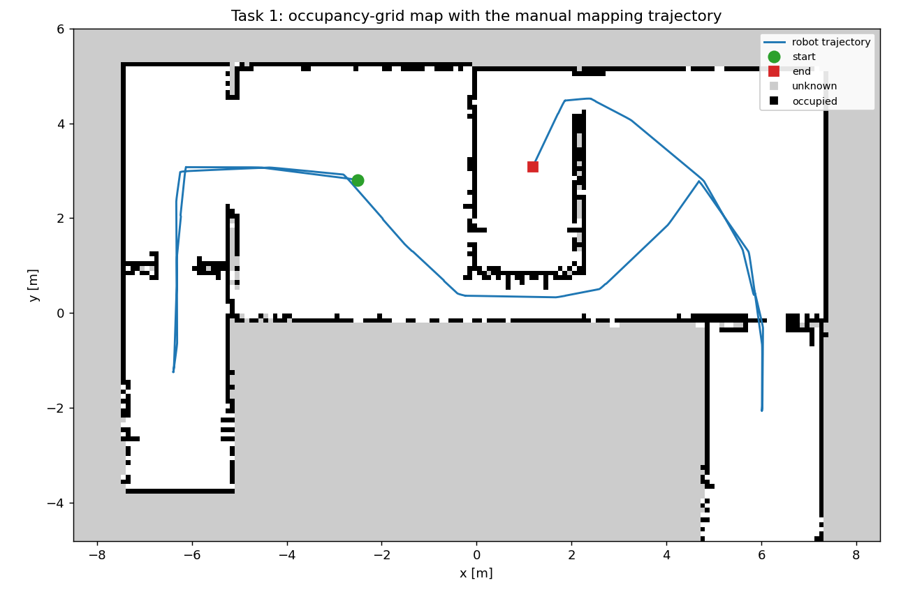

*Final occupancy grid (white free, black occupied, grey unknown; 0.10 m cells) with the complete manual mapping trajectory. Every room and doorway along the route B‑A‑F‑A‑B‑G‑D‑E‑D‑C is mapped. The grey area at the bottom middle is outside the house.*

## Task 2 — A* checkpoint navigation

`astar` searches 8-connected over **known-free** cells only (unknown and occupied are blocked). It uses the octile-distance heuristic (admissible and consistent), a closed set with lazy deletion of stale heap entries, and **no corner cutting**: a diagonal step needs both side cells free. It returns the start→goal cell list, or [] if there is no path.

The mission (default seed) generated all six checkpoints across the map, in rooms F, G, E, A, C and D. The robot completed **HOME → CP1 → … → CP6 → HOME**, printing `MISSION_COMPLETE` after **332.4 s and 71.2 m** of travel.

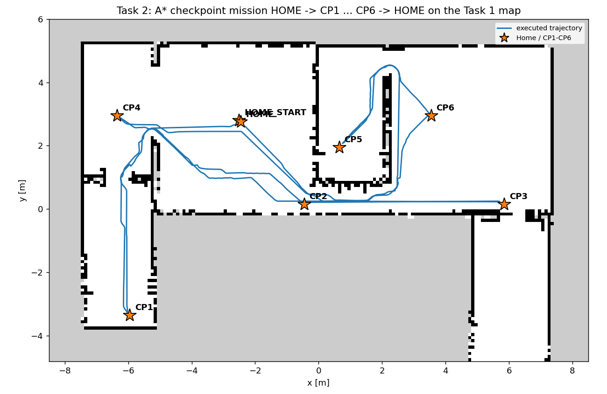

*Executed trajectory on the Task 1 map, with Home and CP1–CP6 (stars). Each leg follows the corridor and doorway centres, the routes A* finds through the inflated map.*

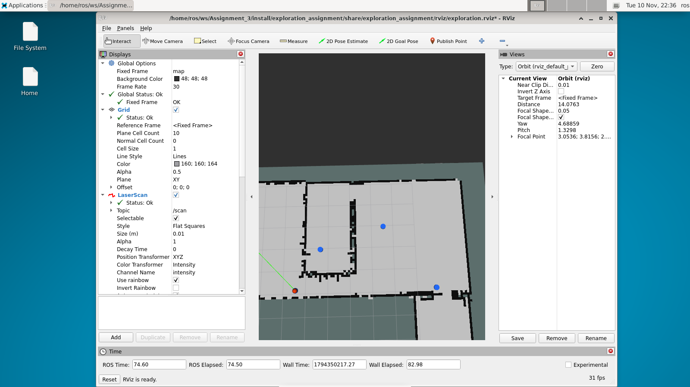

*RViz during the mission: the Task 1 map, checkpoint markers (blue), the robot (red) and the current A* path (green) toward the active checkpoint.*

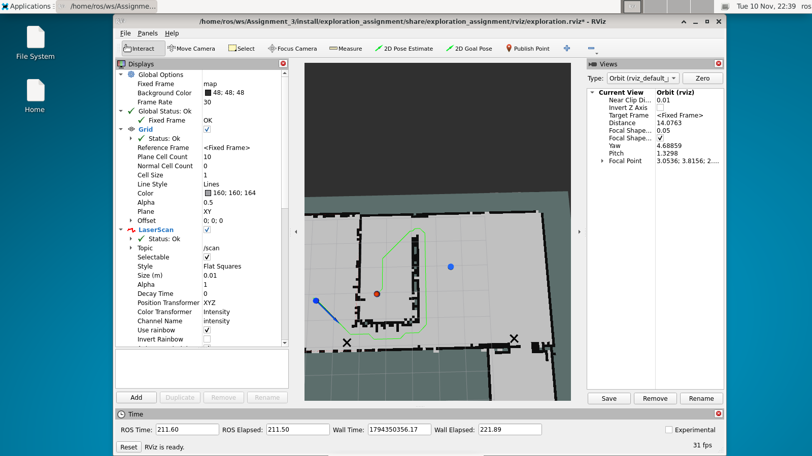

*A later moment in the mission (heading to CP5), with the replanned path.*

## Task 3 — Frontier detection and clustering

A frontier cell is known free with at least one **4-connected** unknown neighbour. It is computed with vectorised neighbour shifts, so out-of-bounds neighbours never occur. Frontier cells are grouped by an **8-connected** BFS with a visited mask, so each cell joins at most one cluster. Clusters smaller than `min_cluster_size` are discarded.

```text
[PASS] single frontier cluster
[PASS] two disconnected frontier clusters
[PASS] minimum cluster-size filtering
[PASS] fully known map has no frontiers
[PASS] frontier detection uses 4-connected unknown neighbours
--------------------------------------------------------------
Passed 5/5 tests.
ALL TASK 3 SELF-CHECKS PASSED
```

(Full output in `submission/task3_self_check_output.txt`. Task 4's own self-check also passes 5/5.)

## Task 4 — Greedy largest-frontier exploration

`largest_frontier` picks the cluster with the most cells (first wins ties; empty clusters ignored) and returns its representative cell in world coordinates. Result: `EXPLORATION_COMPLETE` after **339 s, 47.7 m**, with 9,285 known cells (**92%** of the Task 1 area).

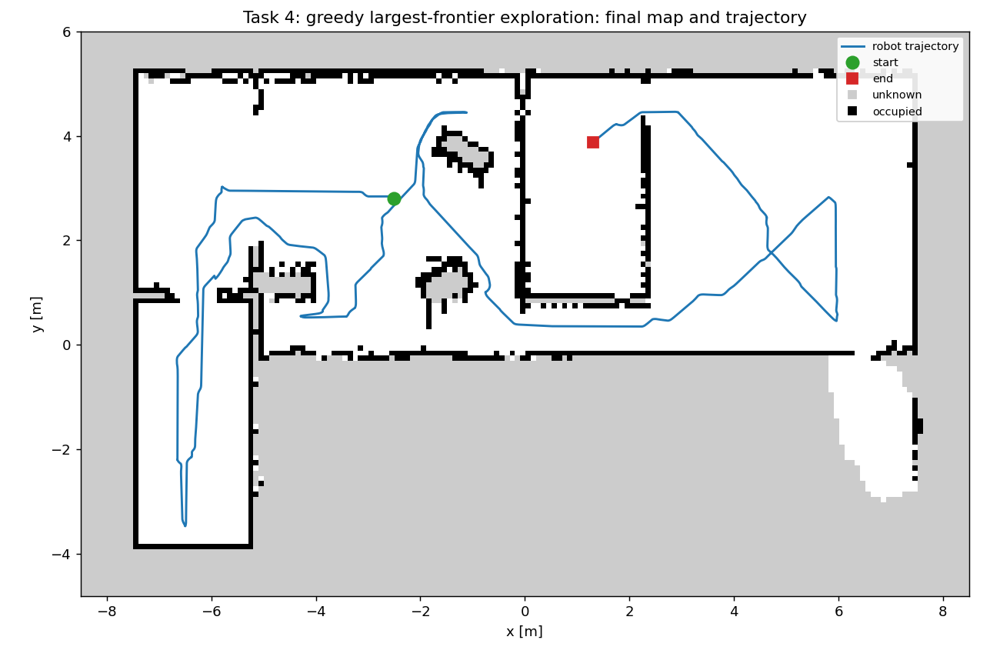

*Greedy run: final map and trajectory (start green, end red). The robot first goes west (rooms A/F), returns past the start, and only later crosses the corridor into the east room and room D. The south-east room is seen only through its doorway when exploration ends.*

## Task 5 — MCTS frontier exploration

`mcts_frontier`:

- **Actions:** the representative cells of the (up to 18) largest clusters.
- **Information gain:** each action's set of currently-unknown cells it would reveal (`_unknown_visible_cells_from`, sensor range), precomputed once per decision.
- **Tree state:** current hypothetical position, remaining actions, and the set of cells already revealed in this sequence.
- **Step reward:** `gain_weight · |new cells not yet revealed| − distance_weight · travel (m)`. This is **marginal** gain, so overlapping viewpoints are not double-counted.
- **Selection:** UCT, `Q̄ + c·√(ln N / n)`, with Q̄ min–max normalised over the siblings so `c = 1.4` is meaningful at any reward scale.
- **Expansion:** one untried action per iteration, up to the horizon (`rollout_depth`).
- **Rollout:** random remaining actions to the horizon.
- **Backpropagation:** each node accumulates the return from its own action onward.
- **Decision:** the most-visited root child (mean value breaks ties).
- **Debug:** rollouts, the best (most-visited) branch and the root N/Q stats are written to `MCTS_DEBUG` for RViz.

Result: `EXPLORATION_COMPLETE` after **437.8 s, 64.1 m**, with 10,078 known cells (**100%** of the Task 1 area).

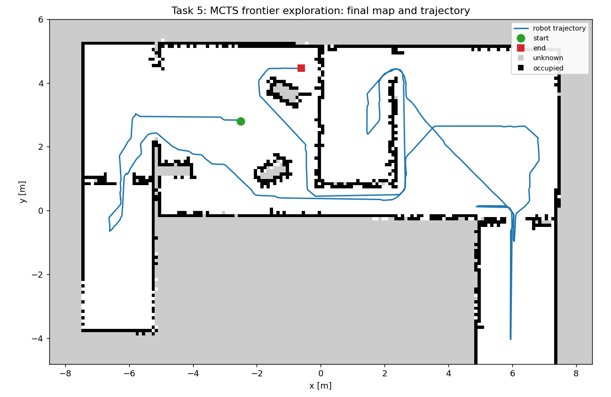

*MCTS run: final map and trajectory. After the west rooms it heads for the corridor and the large east rooms while their frontiers are big and cheap, then returns for the remaining small frontiers, including the south-east room.*

## Task 6 — Greedy exploration plots

Exploration progress = known area ÷ known area of the Task 1 manual map. Map entropy is the value logged by the node.

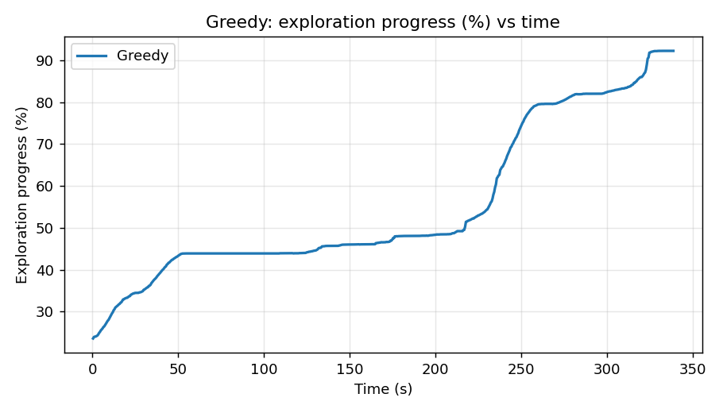

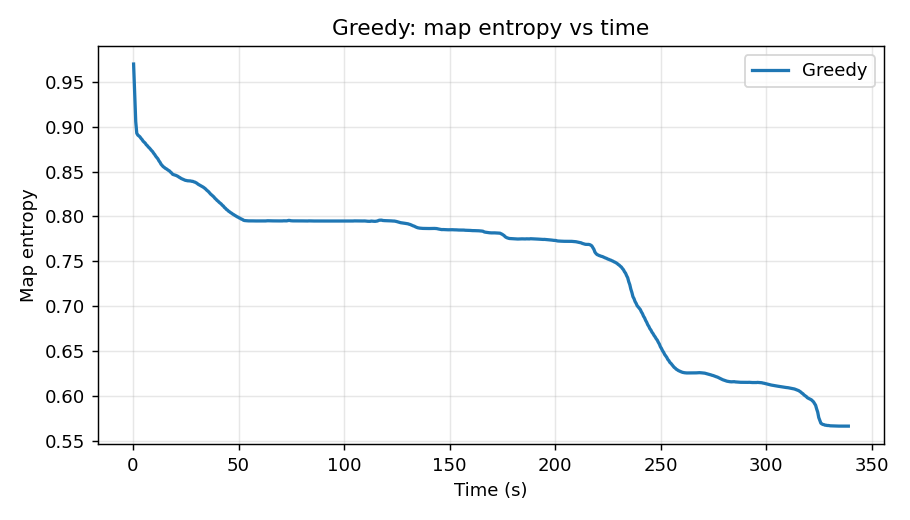

## Task 7 — MCTS exploration plots

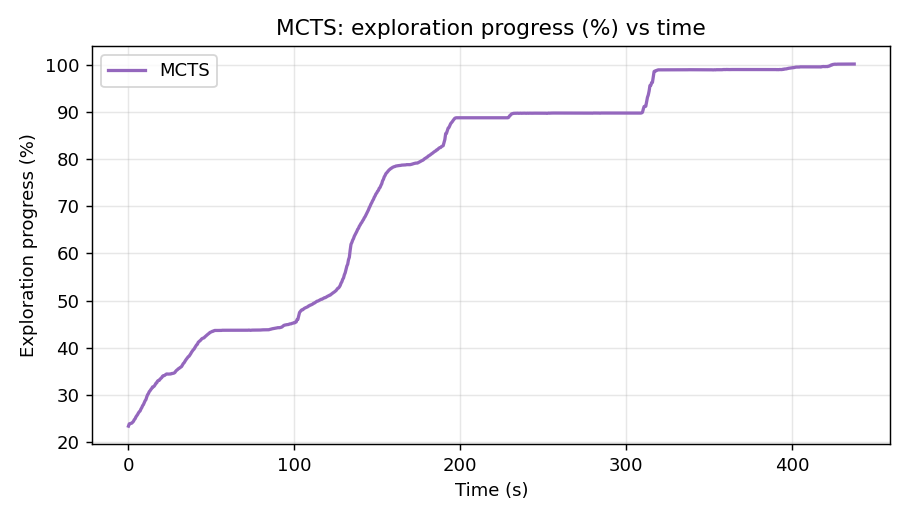

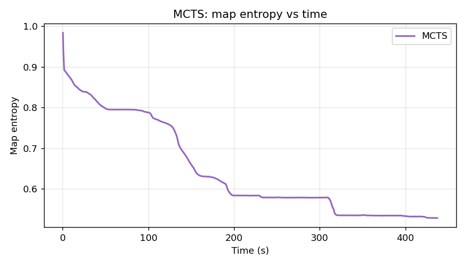

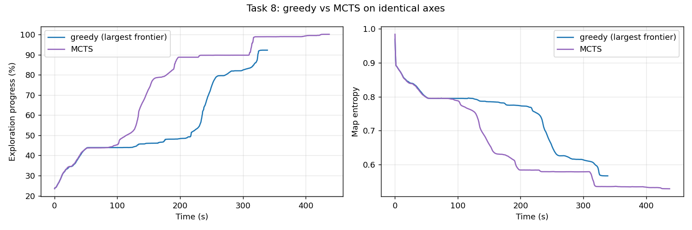

*Both methods on identical axes (Task 8).*

| | 50% | 80% | 90% | final coverage | duration | travel | entropy (start → end) |
|---|---|---|---|---|---|---|---|
| Greedy | 217 s | 273 s | 324 s | 92.2% | 339 s | 47.7 m | 0.970 → 0.567 |
| MCTS | **115 s** | **179 s** | **310 s** | **100%** | 438 s | 64.1 m | 0.984 → **0.528** |

## Task 8 — Analysis: greedy vs MCTS

**1. Was greedy effective?** Partly. It explored the house without getting stuck and terminated by itself, mapping 92% of the area. Its weakness is visible in the progress curve: a **plateau from ≈ 50 s to ≈ 220 s** where coverage creeps from 44% to 48%. The largest frontier cluster at that time was a long but low-value one: the edges of furniture and walls around the start room and the west rooms. Many frontier cells along a boundary do not mean much unseen area behind it. The robot spent almost three minutes there before the corridor frontier became the largest. Greedy also ignores travel cost, which is why its trajectory doubles back past the start. It ended with the south-east room only seen through its doorway, because by then no remaining cluster was large enough to be worth selecting.

**2. How did MCTS differ?** Up to ≈ 50 s the two runs are identical, since there is one obvious frontier. Then MCTS went for the corridor and the east rooms: their frontiers reveal many *new* cells for a moderate travel cost, and the rollouts showed that the follow-up frontiers there also have high marginal gain. Coverage jumped from 44% to 89% between 90 s and 200 s, and entropy dropped from 0.79 to 0.58 in the same window, while greedy was still on its plateau. MCTS reached 50% in 115 s (greedy 217 s) and 80% in 179 s (greedy 273 s).

**3. Which explored more efficiently?** MCTS, by time to high coverage and by final map quality: 1.9× faster to 50%, 1.5× faster to 80%, 100% vs 92% final coverage, and a lower final entropy. Greedy terminated earlier (339 s vs 438 s) and travelled less (47.7 m vs 64.1 m), but only because it stopped with part of the house unexplored. Per metre travelled, MCTS gained more information early. Its extra distance came at the end, returning for small frontiers that greedy never visited.

**4. Which should generalise better?** MCTS. Greedy's rule assumes "more frontier cells = more to see", which fails whenever long thin frontiers along cluttered walls or furniture outnumber a short frontier at a doorway leading to a large unexplored room. Office-like layouts with long corridors and many rooms produce exactly that. Greedy also has no notion of travel cost or of what will be visible *after* the next goal, so it oscillates between distant regions. MCTS's reward weighs marginal information gain against distance, and its rollouts evaluate *sequences* of frontiers. That makes it prefer frontiers that open up more frontiers and avoid revisiting cells already covered by a nearby viewpoint, which holds whatever the layout. Its costs are compute (iterations per decision) and sensitivity to `gain_weight`/`distance_weight`: with a high distance weight it can behave like nearest-frontier, and with a low one like greedy. In a very small or open environment the two would perform similarly, because there are few genuinely different sequences to compare.
